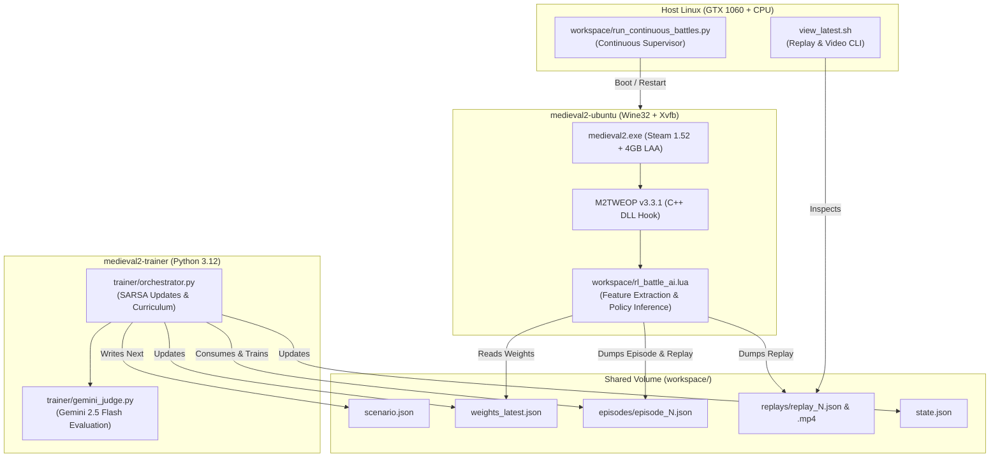

# Medieval II: Total War — Autonomous RL Battle AI

[](https://opensource.org/licenses/MIT)
[](https://www.python.org/downloads/release/python-3120/)
[](https://www.docker.com/)
[](https://github.com/youneuoy/M2TWEOP-library)

An end-to-end headless Reinforcement Learning (RL) environment and tactical AI for *Medieval II: Total War* (Steam v1.52). The agent operates in real-time inside the native DirectX/C++ engine via M2TWEOP Lua hooks, training across diverse battlefield scenarios at **150x simulation speed**.

---

## Key Features

- **Headless Docker Simulation**: Runs Wine32 + Xvfb at 1024x768 with Direct3D 9 acceleration inside Docker (`medieval2-ubuntu`).
- **High-Speed Simulation**: Runs at **150x in-game speed**, completing full 20v20 tactical battles in **~20–22 wall-clock seconds**.
- **SARSA($\lambda$) Linear Function Approximation**: Egocentric 430-dimensional state vector (global indicators + local unit dynamics + 8x8 spatial grid with 6 binary channels).
- **3-Phase Curriculum Learning**:
  - **Phase 1 (Battles 1–50)**: Imitation Learning baseline observing native Total War AI.
  - **Phase 2 (Battle 51+)**: Active RL policy vs. Total War native AI.
  - **Phase 3**: Self-play against frozen historical checkpoints.
- **2D Tactical Video Renderer**: Renders color-coded 1280x720 30fps tactical battle replays distinguishing our AI (Cyan) from the default Total War AI (Crimson).
- **Zero Host Impact**: The host Steam installation (`~/.steam/`) remains strictly untouched; game files and wine prefixes are isolated in project volumes.

---

## System Architecture



---

## Quick Start

### 1. Requirements
- Docker & Docker Compose
- NVIDIA GPU (optional, for inference acceleration)
- Medieval II: Total War (Steam install on host)

### 2. Initial Setup
```bash
# 1. Hardlink Steam game files and unpack M2TWEOP (Steam install untouched)
./setup_game.sh

# 2. Build and start containers
docker compose up -d --build
```

### 3. Start Continuous Battle Loop
```bash
python3 -u workspace/run_continuous_battles.py
```

### 4. Inspect Replays & Watch Videos
```bash
# Display battle statistics, unit casualties, ASCII grid, and open rendered MP4
./view_latest.sh --open
```

---

## Documentation Links

- [Technical Specifications & Math (docs/SPECS.md)](file:///home/tomek/medieval2-docker/docs/SPECS.md): State representation, action space, SARSA($\lambda$) equations, reward formulation.
- [Agent & Developer Guide (docs/AGENT_GUIDE.md)](file:///home/tomek/medieval2-docker/docs/AGENT_GUIDE.md): Internal conventions, M2TWEOP Lua API quirks, troubleshooting, and operations runbook.
- [Original Design Document (m2tw_rl_ai_design_doc.md)](file:///home/tomek/medieval2-docker/m2tw_rl_ai_design_doc.md): System architecture and design trade-offs.

---

## Repository Layout

```
.
├── docker-compose.yml             # Container definitions (medieval2-ubuntu & trainer)
├── Dockerfile                     # Wine32 + Xvfb container definition
├── setup_game.sh                  # Hardlinks game files & installs M2TWEOP
├── view_latest.sh                 # Convenience CLI for replay inspection
├── docs/
│   ├── SPECS.md                   # Technical specifications & mathematical formulas
│   └── AGENT_GUIDE.md             # Developer & AI agent runbook
├── workspace/
│   ├── run_continuous_battles.py  # Autonomous supervisor managing the training loop
│   ├── view_latest_battle.py      # Terminal replay inspector
│   ├── render_replay_video.py     # 2D tactical MP4 video renderer
│   ├── rl_battle_ai.lua           # In-game feature extraction & decision engine
│   ├── state.json                 # Curriculum state (phase, battle count, rolling record)
│   ├── weights_latest.json        # Active SARSA policy weights
│   ├── episodes/                  # Raw battle transition trajectories
│   └── replays/                   # Compact JSON replays & rendered MP4 videos
└── trainer/
    ├── Dockerfile                 # Python 3.12 trainer container image
    ├── orchestrator.py            # Watches episodes, updates weights, runs curriculum
    ├── sarsa_trainer.py           # Linear SARSA(λ) true online eligibility trace updates
    ├── scenario_generator.py      # Random scenario generation (factions, rosters, weather)
    └── gemini_judge.py            # Gemini 2.5 Flash tactical evaluation judge
```

---

## License
MIT License. Total War is a registered trademark of The Creative Assembly / SEGA. This repository contains only custom orchestration scripts, RL algorithms, and Lua plugins. No proprietary game assets are distributed.
