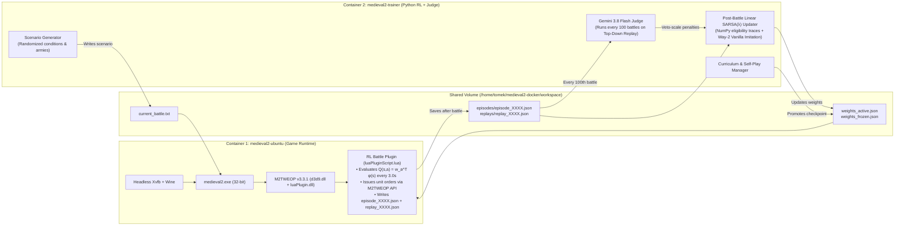

# M2TW Battle AI: Decentralized Linear SARSA($\lambda$) + LLM Judge — Full Design Document

> [!IMPORTANT]
> **Project Goal:** Replace *Medieval II: Total War*’s rigid 6-state C++ middle-layer Battle FSM (`AI_TACTIC_ATTACK_BATTLEGROUP` / `AI_TACTIC_DEFEND_ABSTRACT`) with a **decentralized, unit-level Reinforcement Learning policy** powered by **Linear SARSA($\lambda$)**, warm-started from Vanilla AI’s 3-second physical displacements, and regularized every 100 battles by **Gemini 3.8 Flash** evaluating a compact top-down battle replay for historical cohesion and anti-cheese fairness.

---

## 1. System Architecture & Two-Container Docker Runtime

The training and execution environment runs in two cooperating Docker containers orchestrated via `docker-compose.yml` in [`/home/tomek/medieval2-docker/`](file:///home/tomek/medieval2-docker/docker-compose.yml):



### Container Responsibilities

1. **`medieval2-ubuntu` (Game Container):**
   - Mounts the host’s existing Windows installation of *Medieval II: Total War* + `M2TWEOP-3.3.1` overlay.
   - Runs `medieval2.exe` inside `xvfb-run` under Wine at accelerated battle speed (`battleData.speed = 6.0`).
   - Runs the **M2TWEOP LuaJIT plugin**, which is **inference + logging only** during the battle:
     - Loads `weights_active.json` (and `weights_frozen.json` when in Self-Play mode) at battle start.
     - Every **3.0 seconds** of battle time, extracts $\boldsymbol{\phi}(\mathbf{g}_{\text{battle}}, \mathbf{l}_i)$ for each unit, selects primitive action $a_i$ via $\varepsilon$-greedy Linear SARSA, issues the engine command, and logs the transition.
2. **`medieval2-trainer` (Python RL & Judge Container):**
   - Generates randomized battle configurations (map coordinates, weather, time of day, terrain, **randomized factions for both sides** — each army's roster is drawn from its faction's `descr_sm_factions`/EDU unit pool — and standardized-with-variance army compositions). Because faction/unit pools differ, the policy relies on unit *type/class/stats* features (never faction identity or unit names) so it generalizes across factions.
   - Watches for completed `episode_XXXX.json` files after each battle and runs the **Linear SARSA($\lambda$)** weight update in NumPy.
   - Every **100 battles**, formats the compact top-down battle history (`replay_XXXX.json`) and queries **Gemini 3.8 Flash** to score fairness/cohesion and apply heavy penalties to exploitative feature-action weights.

---

## 2. State Representation: $\boldsymbol{\phi}(s_i) = [\mathbf{g}_{\text{battle}}, \mathbf{l}_i, \text{Grid}_i]$

Every **3.0 seconds** of in-game battle time (`battleData.secondsPassed`), we define the **Army Coordinate Frame**:

- **Origin $(X_0, Y_0)$:** Center of mass of non-routing friendly units.
- **Forward Axis ($\hat{\mathbf{u}}_{\text{fwd}}$):** Unit vector pointing from $(X_0, Y_0)$ toward the center of mass of visible enemy units.
- **Right Axis ($\hat{\mathbf{u}}_{\text{right}}$):** Orthogonal vector $90^\circ$ clockwise from $\hat{\mathbf{u}}_{\text{fwd}}$.

All positions are projected into $(x_{\text{rel}}, y_{\text{rel}})$ in meters relative to this frame.

### A. Global Battle Context Vector ($\mathbf{g}_{\text{battle}}$ — 20 Features, Normalized to $[-1, 1]$ or $[0, 1]$)

| #   | Feature Name               | Definition / Formula                                                                                                                   | Purpose                                 |
|:--- |:-------------------------- |:-------------------------------------------------------------------------------------------------------------------------------------- |:--------------------------------------- |
| 1   | `bias`                     | Constant $1.0$                                                                                                                         | Linear baseline intercept per action    |
| 2   | `time_elapsed_norm`        | $\min(1.0, \text{secondsPassed} / 1800.0)$                                                                                             | Battle phase awareness (early/mid/late) |
| 3   | `own_soldiers_norm`        | $\text{AliveSoldiers}_{\text{own}} / \text{StartSoldiers}_{\text{own}}$                                                                | Remaining friendly army health          |
| 4   | `enemy_soldiers_norm`      | $\text{VisibleAliveSoldiers}_{\text{enemy}} / \text{StartSoldiers}_{\text{enemy}}$                                                     | Remaining enemy army health             |
| 5   | `casualty_balance`         | $(\text{LostRatio}_{\text{enemy}} - \text{LostRatio}_{\text{own}}) \in [-1, 1]$                                                        | Net attrition advantage                 |
| 6   | `center_str_balance`       | $\tanh\left(\frac{\text{OwnStr}(\|x_{\text{rel}}\| \le 80, \|y_{\text{rel}}\| \le 60) - \text{EnemyFrontStr}}{\text{TotalStr}}\right)$ | Mainline strength balance               |
| 7   | `left_wing_balance`        | $\tanh\left(\frac{\text{OwnStr}(x_{\text{rel}} < -80) - \text{EnemyLeftStr}}{\text{TotalStr}}\right)$                                  | Left wing security / advantage          |
| 8   | `right_wing_balance`       | $\tanh\left(\frac{\text{OwnStr}(x_{\text{rel}} > +80) - \text{EnemyRightStr}}{\text{TotalStr}}\right)$                                 | Right wing security / advantage         |
| 9   | `reserve_ratio`            | $\text{OwnStr}(y_{\text{rel}} < -50\text{m}, \text{unengaged}) / \text{OwnTotalStr}$                                                   | Uncommitted tactical reserve pool       |
| 10  | `ranged_dominance`         | $\frac{\text{OwnMissileStr} - \text{EnemyMissileStr}}{\text{OwnMissileStr} + \text{EnemyMissileStr} + 1}$                              | Who wins a standoff shootout            |
| 11  | `mobility_dominance`       | $\frac{\text{OwnCavStr} - \text{EnemyCavStr}}{\text{OwnCavStr} + \text{EnemyCavStr} + 1}$                                              | Who owns flank speed superiority        |
| 12  | `center_engaged_ratio`     | Fraction of friendly frontline units with `isEngaged == true`                                                                          | Signals whether the main line is pinned |
| 13  | `own_general_alive`        | $1.0$ if friendly general unit is alive & not routing, else $0.0$                                                                      | Leadership intact                       |
| 14  | `enemy_general_alive`      | $1.0$ if enemy general is alive & not routing, else $0.0$                                                                              | Enemy leadership status                 |
| 15  | `own_morale_avg`           | Mean morale state of friendly units scaled to $[0, 1]$ (`routing=0 .. impetuous=1`)                                                    | Army cohesion / rout risk               |
| 16  | `enemy_morale_avg`         | Mean morale state of visible enemy units scaled to $[0, 1]$                                                                            | Enemy collapse proximity                |
| 17  | `ground_control_score`     | Fraction of contested central battlefield tiles closer to friendly non-routing units than enemy units                                  | Overall battlefield map control         |
| 18  | `is_siege_or_settlement`   | $1.0$ if `battleResidence` / plaza exists on map, else $0.0$                                                                           | Settlement battle flag                  |
| 19  | `holding_settlement_plaza` | $+1.0$ if friendly controls plaza, $-1.0$ if enemy controls, $0$ if neutral/none (`plazaData`)                                         | Explicit settlement holding metric      |
| 20  | `plaza_capture_timer_norm` | Signed normalized plaza capture countdown (`plazaData.plazaControl / plazaMaxTime`)                                                    | Urgency to contest town square          |

---

### B. Local Unit Sensors ($\mathbf{l}_i$ — 26 Features, Own Stats & Type + Local Context)

*(Note: Excludes target unit stats per design decision).*

1. **Unit Type & Capabilities (10 Binary Features):**
   - `is_infantry`, `is_cavalry`, `is_siege_or_handler`
   - `class_heavy`, `class_light`, `class_missile`, `class_spearmen`, `class_skirmish`
   - `can_phalanx_or_schiltrom`, `has_bonus_vs_cav`
2. **Own Normalized Combat Stats (7 Continuous Features $\in [0, 1]$):**
   - `stat_melee_attack` (`eduEntry.statPri.attack / 25.0`)
   - `stat_charge_bonus` (`eduEntry.statPri.charge / 15.0`)
   - `stat_missile_attack` (`eduEntry.statPri.missileAttack / 20.0`)
   - `stat_missile_range` (`eduEntry.statPri.range / 250.0`)
   - `stat_total_defense` (`(armour + defenseSkill + shield) / 35.0`)
   - `stat_move_speed` (`moveSpeedMod / 2.5`)
   - `stat_mass` (`mass / 5.0`)
3. **Own Live Status & Position (7 Continuous/Binary Features):**
   - `rel_x_norm` ($x_{i,\text{rel}} / 300.0$), `rel_y_norm` ($y_{i,\text{rel}} / 300.0$) — where Unit $i$ is relative to our army center
   - `health_ratio` (`soldiersAlive / soldiersStart`)
   - `morale_norm` (`moraleLevel / 6.0`), `fatigue_norm` (`fatigueLevel / 6.0`), `ammo_ratio` (`currentAmmo / maxAmmo`)
   - `is_engaged` ($1/0$), `is_under_fire` ($1/0$)
4. **Local Proximity Counts:**
   - `near_friendly_soldiers_80m` ($\text{count} / 500.0$)
   - `near_enemy_soldiers_80m` ($\text{count} / 500.0$)

---

### C. Unit $i$'s Egocentric $200\text{m} \times 200\text{m}$ Low-Res 2D Map ($\text{Grid}_i$)

Centered on Unit $i$'s current position $(x_i, y_i)$ and aligned with the battle forward axis $\hat{\mathbf{u}}_{\text{fwd}}$, we construct an **$8 \times 8$ grid** covering $[-100\text{m}, +100\text{m}] \times [-100\text{m}, +100\text{m}]$ (each cell is $25\text{m} \times 25\text{m}$):

- **Raw Cell Information (Allegiance + Unit Status):**
  - **Allegiance:** `0` = Empty, `1` = Friendly unit(s) present, `2` = Enemy unit(s) present
  - **Unit Status (for occupied cells):**
    - `hold` — Holding position / braced / reforming
    - `attacking` — Engaged in melee or charging
    - `firing` — Actively shooting missiles
    - `fleeing` — Routing / fleeing (`moraleLevel == routing`)
- **Linear Feature Encoding of the Grid ($64 \times 6 = 384$ Binary Features):**
  - Because Linear SARSA takes a dot product $\mathbf{w}_a^\top \boldsymbol{\phi}(s)$, feeding raw integers $\{0, 1, 2\}$ into a linear weight would falsely imply $\text{Enemy} (2) = 2 \times \text{Friendly} (1)$.
  - Instead, each of the $8 \times 8 = 64$ cells is represented as **6 binary indicators** (2 allegiance bits + 4 unit status bits):
    1. `cell_friendly[r, c]` $\in \{0, 1\}$ (Friendly unit in cell)
    2. `cell_enemy[r, c]` $\in \{0, 1\}$ (Enemy unit in cell)
    3. `status_hold[r, c]` $\in \{0, 1\}$ (Unit in cell is holding / braced)
    4. `status_attacking[r, c]` $\in \{0, 1\}$ (Unit in cell is attacking / in melee)
    5. `status_firing[r, c]` $\in \{0, 1\}$ (Unit in cell is firing missiles)
    6. `status_fleeing[r, c]` $\in \{0, 1\}$ (Unit in cell is fleeing / routing)
  - Because at most 2 bits (`1 allegiance + 1 status`) are non-zero in any occupied cell, sparse dot-product evaluation in Lua still only sums over the ~10–15 occupied cells while giving the AI tactical visibility into whether nearby units are **holding, attacking, firing, or fleeing**.

> **Total Feature Vector Dimension:**
> $|\boldsymbol{\phi}(s_i)| = 20\text{ (Global)} + 26\text{ (Local Stats/Sensors)} + 384\text{ (200m Grid with Status)} = \mathbf{430\text{ features}}$.
> To allow **Infantry, Spearmen, Missiles, and Cavalry** to learn distinct weights, we maintain a weight matrix $\mathbf{W}_{\text{role}} \in \mathbb{R}^{|A| \times 430}$ for each of the 4 core unit archetypes (`MeleeInf`, `SpearInf`, `Missile`, `Cavalry`).

---

## 3. Primitive Action Space ($A$) & Sequential Coordination

Every **3.0 seconds**, Unit $i$ chooses from **13 Primitive Actions** $a \in \{0, \dots, 12\}$:

### A. 9 Relative Offset Movement Actions (`unit:moveToPosition(x + dx, y + dy, run)`)

Moves Unit $i$ by a $60\text{m}$ offset vector in the army coordinate frame (using default walk/run heuristic: walk if $>150\text{m}$ from enemy and not flanking/under fire, run otherwise):

- $a_0$: **Move Forward** $(0, +60\text{m})$
- $a_1$: **Move Forward-Left** $(-45\text{m}, +45\text{m})$
- $a_2$: **Move Forward-Right** $(+45\text{m}, +45\text{m})$
- $a_3$: **Move Left** $(-60\text{m}, 0)$
- $a_4$: **Move Right** $(+60\text{m}, 0)$
- $a_5$: **Move Back-Left** $(-45\text{m}, -45\text{m})$
- $a_6$: **Move Back-Right** $(+45\text{m}, -45\text{m})$
- $a_7$: **Move Backward / Pull Back** $(0, -60\text{m})$
- $a_8$: **Hold Position & Brace** $(0, 0)$ (`unit:halt()`)

### B. 4 Directional Target Attack Actions (`unit:attackUnit(target, run)`)

Uses the engine's **default attack mode** for Unit $i$ (if Unit $i$ is a missile unit with ammo and target is in range, native `attackUnit` fires missiles; if melee or out of ammo, native `attackUnit` charges into melee):

- $a_9$: **Attack Nearest Enemy in Front Quadrant**
- $a_{10}$: **Attack Nearest Enemy in Left Quadrant**
- $a_{11}$: **Attack Nearest Enemy in Right Quadrant**
- $a_{12}$: **Attack Nearest Enemy in Rear Quadrant (or Absolute Nearest if none in quadrant)**

### C. Sequential Global-State Update Within Each Tick

When looping over friendly units $i = 1 \dots N$ at tick $t$:

- As soon as Unit $i$ selects a movement offset $(\Delta x, \Delta y)$, its projected new position is immediately reflected in the sector balances (`left_wing_balance`, `center_str_balance`, `right_wing_balance`, `reserve_ratio`) before Unit $i+1$ evaluates $Q(s_{i+1}, a)$—preventing all units from piling onto the same wing.

---

## 4. Three-Phase Learning Curriculum & Mathematical Formulation

### Phase 1: Vanilla AI Reproduction via Way 2 (3-Second Physical Displacement)

During the first $N_{\text{imit}} \approx 50$ battles, we warm-start $\mathbf{W}_{\text{role}}$ so the policy begins from Vanilla AI's baseline behavior:

1. Over each 3-second interval $[t, t+3\text{s}]$, we record where Unit $i$ was at $t$ $(x_t, y_t)$ and where Vanilla AI physically moved it by $t+3\text{s}$ $(x_{t+3}, y_{t+3})$, plus whether Vanilla AI engaged an enemy unit in quadrant $q$.
2. We map the actual 3-second displacement $\Delta \mathbf{p}_{\text{actual}} = (x_{t+3} - x_t, y_{t+3} - y_t)$ to the corresponding primitive action $a^*_{\text{vanilla}} \in \{0 \dots 12\}$.
3. Every candidate action $a_t$ receives the **Way-2 Displacement Imitation Reward**:
   $$R_{\text{imit}}(s_t, a_t) = -\lambda_{\text{imit}} \cdot \text{dist}_{\text{action}}\big(a_t, a^*_{\text{vanilla}}\big)^2$$
   where $\text{dist}_{\text{action}}$ is the normalized Euclidean distance between the 3-second target endpoint of $a_t$ and the actual 3-second displacement $(x_{t+3}, y_{t+3})$.

### Phase 2: Combat RL vs. Vanilla AI (Imitation Penalty Removed Completely)

Once Phase 1 finishes warm-starting the weights from Vanilla AI, Lua takes full control of all friendly units and **the imitation penalty disappears completely** ($\lambda_{\text{imit}} = 0$ — hard cutover so the agent is completely free to discover superior tactics beyond Vanilla AI).

At each 3-second step $t$, Unit $i$ receives the **Combined Local + Global Combat Step Reward**:
$$r_{i, t} = \underbrace{w_{\text{loc}} \big(\Delta \text{Kills}_{i,t} - \Delta \text{Losses}_{i,t}\big)}_{\text{Unit } i\text{'s Local Trade}} + \underbrace{w_{\text{glob}} \big(\Delta \text{EnemyCasualties}_t - \Delta \text{OwnCasualties}_t\big)}_{\text{Team Attrition}} + \underbrace{w_{\text{map}} \big(\Delta \text{GroundControl}_t + \Delta \text{PlazaControl}_t\big)}_{\text{Map & Settlement Control}}$$
Plus a **Terminal Battle Outcome Reward** at step $T$:
$$r_{i, T} \mathrel{+}= \begin{cases} +50.0 & \text{if Victory} \\ -50.0 & \text{if Defeat} \end{cases}$$

### Phase 3: Frozen Checkpoint Self-Play

When the rolling 50-battle win rate against Vanilla AI exceeds **$75\%$**:

- Both sides in battle are controlled by our M2TWEOP Lua plugin:
  - **Side 0 (Learner):** Uses `weights_active.json` with $\varepsilon$-greedy exploration.
  - **Side 1 (Frozen Opponent):** Uses `weights_frozen.json` (greedy $\varepsilon = 0.02$).
- Every **100 battles** (if the Learner's win rate vs. Frozen $> 55\%$ and passes the Gemini Judge check), `weights_active.json` is copied to `weights_frozen.json`.

---

### Post-Battle Linear SARSA($\lambda$) Update in Python

At the end of each battle, `medieval2-trainer` loads `episode_XXXX.json` containing the trajectory $\{(s_{i,t}, a_{i,t}, r_{i,t})\}_{t=0}^T$ for each unit $i$:

1. Initialize eligibility trace matrix $\mathbf{E}_{\text{role}} = \mathbf{0} \in \mathbb{R}^{13 \times 430}$.
2. For $t = 0 \dots T-1$:
   $$\delta_{i,t} = r_{i,t} + \gamma \mathbf{w}_{\text{role}, a_{i,t+1}}^\top \boldsymbol{\phi}(s_{i,t+1}) - \mathbf{w}_{\text{role}, a_{i,t}}^\top \boldsymbol{\phi}(s_{i,t})$$
   $$\mathbf{e}_{\text{role}, a_{i,t}} \leftarrow \mathbf{e}_{\text{role}, a_{i,t}} + \boldsymbol{\phi}(s_{i,t})$$
   $$\mathbf{W}_{\text{role}} \leftarrow \mathbf{W}_{\text{role}} + \alpha \, \delta_{i,t} \, \mathbf{E}_{\text{role}}$$
   $$\mathbf{E}_{\text{role}} \leftarrow \gamma \lambda \, \mathbf{E}_{\text{role}}$$

---

## 5. Compact Top-Down "Battle Video" Format & Gemini 3.8 Flash Judge

### A. Compact Top-Down Battle Replay (`replay_XXXX.json` — ~15–25 KB per Battle)

To give **Gemini 3.8 Flash** a complete "video" of the battle without blowing up context size:

- **Keyframe Interval:** Sampled every **9 seconds** (every 3rd decision tick) + battle start/end ($\sim 30\text{–}60$ keyframes for a typical battle).
- **Header (`roster`):** Lists each unit ID once with its type, class, starting soldier count, and side:
  - Symbol legend: `I`=Heavy Inf, `S`=Spear/Pike, `A`=Archer/Missile, `C`=Cavalry, `G`=General (Uppercase = Our AI, Lowercase = Enemy).
  - Status suffix legend: `H`=Holding/Braced, `A`=Attacking/Melee, `F`=Firing Missiles, `R`=Fleeing/Routing.
- **Per-Keyframe Data (`frames`):**
  1. **Compact $24 \times 24$ Top-Down ASCII Grid** (covering the active battlefield bounding box, where each occupied cell shows `RoleStatus` such as `IH` = Friendly Inf Holding, `AF` = Friendly Archers Firing, `cA` = Enemy Cav Attacking, `sR` = Enemy Spears Fleeing, `..` for empty, `##` for settlement wall/plaza).
  2. **Quantized Unit Table:** Compact array `[unit_id, x_int, y_int, soldiers_pct, morale_code, status_code, action_id]` for each unit (`status_code` $\in \{\text{hold}, \text{attacking}, \text{firing}, \text{fleeing}\}$).

### B. Gemini 3.8 Flash Judge Evaluation (Every 100th Battle)

Every 100th run, `medieval2-trainer` sends the compact replay to **Gemini 3.8 Flash** with a structured JSON output schema:

```json
{
  "cohesion_score": 0.75,
  "fairness_anti_cheese_score": -0.90,
  "exploits_detected": ["red_line_camping", "cavalry_circle_kiting"],
  "bad_time_windows": [[36, 120]],
  "bad_unit_roles_and_actions": [{"role": "Cavalry", "action": 7, "penalty_weight": -1.0}],
  "reasoning": "..."
}
```

- **Strong Corrective Penalty Application (Without Wiping Out Learned Weights):**
  - Since the Judge runs once every 100 battles, we apply a **strong, bounded negative reward penalty** $R_{\text{LLM}} = -25.0 \times |\text{penalty\_weight}|$ (comparable to half a battle defeat, rather than an extreme wipe-out) to the flagged `(role, action)` transitions within $[t_{\text{start}}, t_{\text{end}}]$ during the SARSA($\lambda$) trace update.
  - This firmly nudges the policy away from cheesy/exploitative habits while preserving the useful combat and positioning weights the agent has learned.

---

## 6. Implementation Roadmap

1. **Step 1 — Docker & Wine + M2TWEOP Setup (`/home/tomek/medieval2-docker`):**
   - Update `Dockerfile` and `docker-compose.yml` to add Wine (`wine32:i386`) to `medieval2-ubuntu`, mount your existing Windows *Medieval II* files + `M2TWEOP-3.3.1`, and add the `medieval2-trainer` Python service container.
2. **Step 2 — M2TWEOP Lua RL Plugin (`workspace/rl_battle_ai.lua`):**
   - Implement the 3-second tick timer, army coordinate frame projection, 20-feature Global Context $\mathbf{g}_{\text{battle}}$, 26-feature Own Unit Stats $\mathbf{l}_i$, $8 \times 8$ ($200\text{m}$) 2D local grid, 13 primitive actions, and compact replay logger.
3. **Step 3 — Python Trainer & Gemini 3.8 Flash Judge (`workspace/trainer/`):**
   - Implement `sarsa_trainer.py` (Way-2 Vanilla displacement imitation + Linear SARSA($\lambda$) update), `scenario_generator.py` (randomized conditions & standard-with-variance army generator), and `gemini_judge.py` (every 100th run top-down video evaluator).
4. **Step 4 — Smoke Test & Training Run #1:**
   - Launch a headless test battle inside Docker, verify `episode_0001.json` and `replay_0001.json` generation, and start Phase 1 training.
